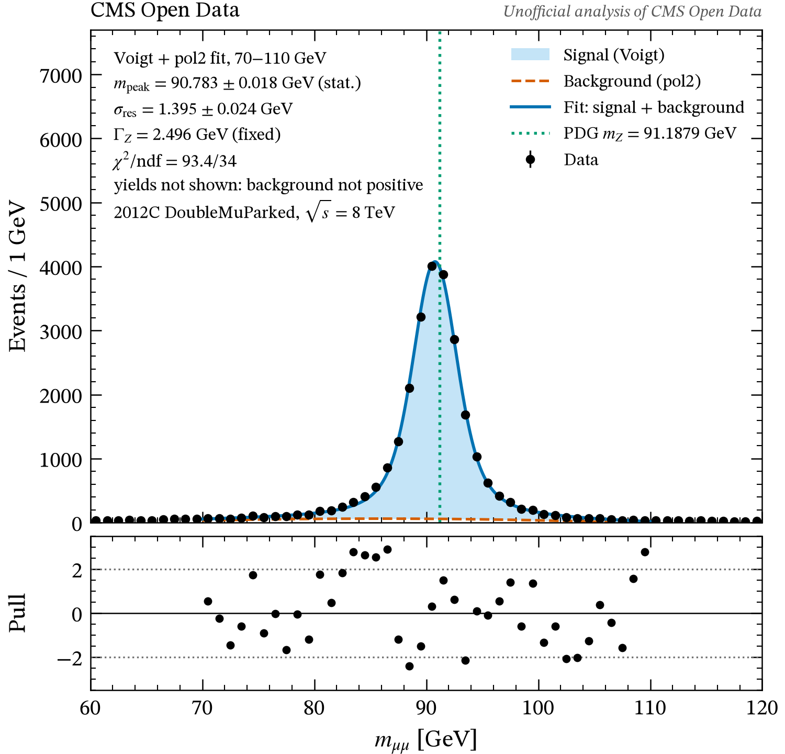

# cmsopen

End-to-end analysis of CMS open data: from NanoAOD ROOT files to the Z boson mass peak.

**Status: under development.** The full physics explanation and usage guide are coming soon.

## Development setup

On macOS with [Homebrew](https://brew.sh). Keep the project outside
iCloud-synced folders such as Desktop and Documents, for example in
`~/Developer`.

```bash
brew install python@3.12 gh
gh auth login
mkdir -p ~/Developer && cd ~/Developer
git clone https://github.com/CyrilCquark/cmsopen.git
cd cmsopen
python3.12 -m venv .venv && source .venv/bin/activate
pip install -e ".[dev]"
```

Download the development data file (about 1.1 GB; see [DATA.md](DATA.md)).
The download is resumable: if it stops, run the same command again.

```bash
curl -fL -C - -o data/45F7AE81-7A79-4CB1-998E-7BD156490294.root \
  https://opendata.cern.ch/eos/opendata/cms/derived-data/NanoAODRun1/01-Jul-22/Run2012C_DoubleMuParked/45F7AE81-7A79-4CB1-998E-7BD156490294.root
stat -f %z data/45F7AE81-7A79-4CB1-998E-7BD156490294.root   # expect 1145602936
```

Point the demo notebooks at the file and run the tests:

```bash
export CMSOPEN_DATA_FILE="$PWD/data/45F7AE81-7A79-4CB1-998E-7BD156490294.root"
pytest
```

## Figures

The final figures of the analysis, made from the real 2012C DoubleMuParked file, are in
[`docs/figures/`](docs/figures/) with a README that says how to regenerate them
(`python examples/make_figures.py`). They are an unofficial analysis of CMS Open Data, not CMS results.


