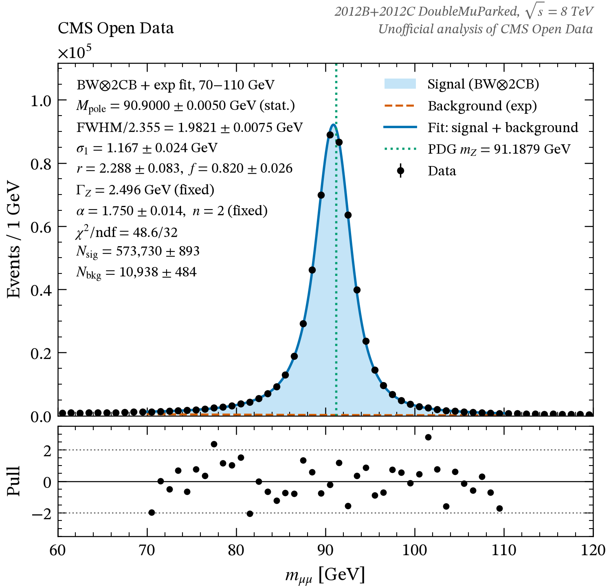
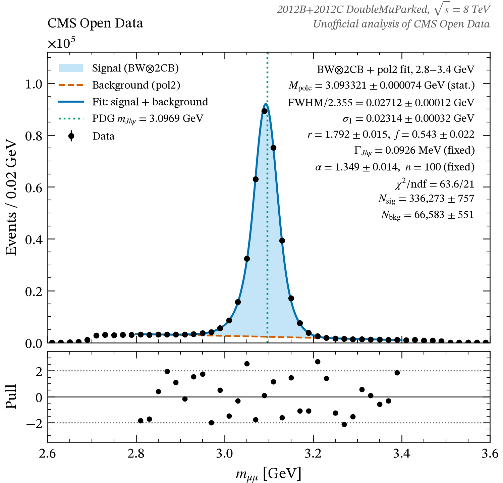
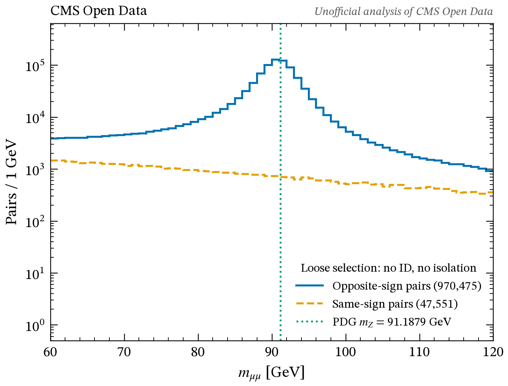

# cmsopen

**From public CMS collision data to the Z and J/ψ mass peaks, in one Python library.**

`cmsopen` reads NanoAOD files from the [CERN Open Data Portal](https://opendata.cern.ch), selects muons, pairs them,
computes each pair's invariant mass, fits the resonance peak and reports the fit with its uncertainties and
validation studies. This is an independent, unofficial analysis of CMS Open Data; nothing here is a CMS result.

## The physics in two minutes

**Invariant mass.** A particle's energy and momentum depend on who is measuring them, but one combination does not:
its mass. In the units particle physicists use, where the speed of light is one,

```text
m² = E² − |p|²
```

Now take a particle that decays to two muons. Energy and momentum are conserved, so the two muons together carry
exactly the parent's energy and momentum. Apply the same formula to the pair,

```text
m(μμ)² = (E₁ + E₂)² − |p₁ + p₂|²
```

and the answer is the mass of the parent, even though the parent itself lived too briefly to reach any detector. Two
measured tracks tell you the mass of something nobody saw.

**Why a peak appears.** Most muon pairs in a collision have no common parent, or come from processes with no preferred
mass, so their invariant masses form a smooth, falling continuum. Pairs from a real particle all land near that
particle's mass. Histogram every pair and the particle shows up as a bump on a smooth background: a *resonance peak*.
The neutral Z boson (PDG mass 91.1879 GeV) and the J/ψ meson (PDG mass 3.0969 GeV) both decay to one μ⁺ and
one μ⁻, which is why the analysis keeps opposite-sign pairs.

**Why the peak has a width and a shape.** Three effects set its shape. A short-lived particle has no perfectly sharp
mass: this *natural width* is a Breit-Wigner curve, large for the Z and tiny for the J/ψ. The detector measures each
momentum imperfectly, which smears the mass by the *resolution*. And a muon can radiate a photon the pair does not
include, which moves some pairs to lower mass and creates a tail on the low side of the peak. The fit models all three
on top of a smooth background.

[More physics background](docs/physics.md).

## Quick start (under five minutes, no large download)

The repository includes a small sample of real collisions, `examples/data/cmsopen_sample.root`. With Python 3.10 or
newer:

```bash
git clone https://github.com/CyrilCquark/cmsopen.git
cd cmsopen
python3.12 -m venv .venv && source .venv/bin/activate
pip install .
```

Then three commands:

```bash
cmsopen analyze examples/data/cmsopen_sample.root --channel Z_mumu --model voigt_poly --no-stability --outdir out/z
cmsopen analyze examples/data/cmsopen_sample.root --channel Jpsi_mumu --model voigt_poly --no-stability --outdir out/jpsi
python examples/layer9_sample_demo.py
```

The first two print a fit summary and write `mass_fit.png`, `cutflow.png`, `os_vs_ss.png`, `summary.txt` and
`summary.json` to `out/`. The third runs the whole chain again with self-checks and ends with `All checks passed`.
The sample is small, so its numbers are a demonstration and are not the results below, and it uses the simpler
`voigt_poly` line shape, because the frozen production models need far more pairs to pin down their parameters.

Worked notebooks: [Z peak](notebooks/01_z_peak.ipynb), [J/ψ peak](notebooks/02_jpsi_peak.ipynb),
[using each module on its own](notebooks/03_modular_usage.ipynb). To run them, `pip install jupyter` first.

## Production results

<!-- RESULTS:BEGIN -->
Results from the pre-registered production sample, 20 files (generated by scripts/render_results.py). Unofficial analysis of CMS Open Data: these are not CMS results.

**Controlling benchmarks and observed values.** A benchmark is a requirement fixed before the sample was opened; it is not a result. The observed column is what was measured; a benchmark that was missed stays listed as not met.

| target | **controlling benchmark** | observed | status |
|---|---|---|---|
| T1 Reproducibility | **summary.json byte-identical on a repeated run (parallel, then serial), every channel** | Z: byte-identical; J/ψ: byte-identical | met |
| T2 Fit adequacy | **chi2/ndf <= 2.0 with a positive background in the fit range** | Z: χ²/ndf 1.518, background positive; J/ψ: χ²/ndf 3.028, background positive | Z: met; J/ψ: not met |
| T3 Peak offset reported | **offset from PDG with raw and scaled stat. errors, fit-choice spread and the diagnostic studies (barrel/endcap, mu+ vs mu-) reported; no numeric target on the mass** | Z: -0.2879 ± 0.0050 (stat.) GeV, fit-choice spread 0.0028 GeV, 8 diagnostic studies; J/ψ: -0.00358 ± 0.00007 (stat.) GeV, fit-choice spread 0.00006 GeV, 8 diagnostic studies | met |
| T4 Statistics | **20 files (12 from record 31129, 8 from record 31123)** | 20 files (12 from record 31129, 8 from record 31123) | met |
| T5 Transparency | **cutflow, files by record and size, commit, environment hash, attempts and timings recorded; the README block is checked afterwards by scripts/check_readme_numbers.py** | recorded: attempts, cutflow, environment sha256, files by record and size, git head, timings | met |
| T6 Run-period consistency | **2012B and 2012C peak and resolution with differences and combined stat. errors, every channel (reported, no threshold)** | Z peak -0.0184 ± 0.0103 GeV (-1.78 σ); Z resolution -0.0059 ± 0.0157 GeV (-0.38 σ); J/ψ peak +0.00000 ± 0.00016 GeV (+0.02 σ); J/ψ resolution +0.00001 ± 0.00026 GeV (+0.03 σ) | met |
| T7 Engineering | **full test suite and quality gates (coverage >= 90 %, mypy and ruff clean) passed at the production HEAD** | record for commit 9ebc2e3a8b37: pytest exit 0, quality exit 0, coverage 96.7%; 494 passed, 2 skipped in 1807.17s (0:30:07) | met |

**Headline fits (observed).** Peak positions are not mass measurements: no muon momentum-scale corrections are applied.

| quantity | Z → μ⁺μ⁻ | J/ψ → μ⁺μ⁻ |
|---|---|---|
| Model, fit range | cb2_bw_exp, 70-110 GeV | cb2_bw_poly2, 2.8-3.4 GeV |
| Events read | 9,780,165 | 9,780,165 |
| Opposite-sign pairs in the fit range | 584,716 | 402,920 |
| Peak (pole) position, observed | 90.9000 GeV | 3.09332 GeV |
| Statistical error, raw | 0.0050 GeV | 0.00007 GeV |
| Statistical error, scaled | 0.0061 GeV (S = 1.232) | 0.00013 GeV (S = 1.740) |
| Resolution, observed | 1.9821 ± 0.0075 GeV | 0.02712 ± 0.00012 GeV |
| χ²/ndf **benchmark** | **≤ 2.0** | **≤ 2.0** |
| χ²/ndf, observed | 48.6 / 32 = 1.518 (met) | 63.6 / 21 = 3.028 (not met) |
| Fit p-value, observed | 0.0305 | 3.59e-06 |
| PDG mass (reference) | 91.1879 GeV | 3.0969 GeV |
| Offset from PDG, observed | -0.2879 GeV | -0.00358 GeV |
| Fit-choice spread, observed | 0.0028 GeV | 0.00006 GeV |
| Alternate fit, observed | voigt_poly: 90.8118 GeV, χ²/ndf 49.712 | voigt_poly: 3.09242 GeV, χ²/ndf 157.451 |
<!-- RESULTS:END -->

**Benchmarks not met in this run: T2 (J/ψ).** They are reported as not met, with the measured values; nothing was refitted or tuned afterwards.

## Figures



*The dimuon mass spectrum around the Z with the fit and pulls.* [Caption with every fit parameter](docs/figures/z_peak_fit_caption.md).



*The same around the J/ψ.* [Caption](docs/figures/jpsi_peak_fit_caption.md).



*Opposite-sign and same-sign pairs for a loose selection: the peak appears only in opposite-sign pairs, as expected
from a neutral parent.* The [figures directory](docs/figures/README.md) also has the cutflow and the muon pT and η
distributions, and PDF versions.

## Method

| channel | model | fit range | muon quality |
|---|---|---|---|
| Z → μ⁺μ⁻ | cb2_bw_exp | 70-110 GeV | tight ID and PF isolation |
| J/ψ → μ⁺μ⁻ | cb2_bw_poly2 | 2.8-3.4 GeV | soft ID |

For each event the analysis requires a channel trigger, applies the muon cuts, keeps events with at least two selected
muons and takes one opposite-sign pair: the one with the highest pT sum, a rule that does not look at the mass. All
analysis choices were fixed on development data and frozen at commit `35af6445db8d`, and the files of the
production sample were chosen by a recorded rule before any of them was opened
([registry](results/production_files.json)). The code is vectorised and processes files in chunks, and results do not
depend on the chunk size or the number of workers.

## Validation and systematics

Observed values on the production sample. Each row is a spread of the fitted peak under a change of analysis choice; these
are studies of the offset, and no systematic uncertainty is combined into the quoted errors.

| study (observed) | Z → μ⁺μ⁻ | J/ψ → μ⁺μ⁻ |
|---|---|---|
| Spread over barrel/endcap categories | 0.2444 GeV | 0.00465 GeV |
| Largest category deviation, in σ | 11.99 raw, 5.74 scaled | 18.63 raw, 6.03 scaled |
| Largest μ⁺ minus μ⁻ difference | 0.2469 GeV | 0.00015 GeV |
| Spread over working points | 0.0221 GeV | 0.00024 GeV |
| Spread over signal models | 0.0189 GeV | 0.00130 GeV |
| Fit-choice standard deviation | 0.0028 GeV | 0.00006 GeV |
| Other background shape | -0.0046 GeV (cb2_bw_poly2) | +0.00006 GeV (cb2_bw_exp) |

Run-period consistency (Run 2012B minus Run 2012C, observed):

| difference (observed) | value | in σ |
|---|---|---|
| Z → μ⁺μ⁻ peak | -0.0184 ± 0.0103 GeV | -1.78 σ |
| Z → μ⁺μ⁻ resolution | -0.0059 ± 0.0157 GeV | -0.38 σ |
| J/ψ → μ⁺μ⁻ peak | +0.00000 ± 0.00016 GeV | +0.02 σ |
| J/ψ → μ⁺μ⁻ resolution | +0.00001 ± 0.00026 GeV | +0.03 σ |

### Every benchmark in the registry

| metric | **controlling benchmark** | observed | status | source of the observed value |
|---|---|---|---|---|
| Production sample size | **20 files (12 from record 31129, 8 from 31123)** | 20 files (12 from record 31129, 8 from record 31123) | met | results/production.json |
| Fit adequacy chi2/ndf (final model, production) | **<= 2.0, with a positive background everywhere in the fit range** | Z 1.518 (met); J/ψ 3.028 (not met) | not met for every channel | results/production.json |
| Line coverage of src/cmsopen | **>= 90 % (`--cov-fail-under=90`)** | 96.7 % | met | gates record of the production commit |
| mypy / ruff findings | **0 (mypy `disallow_untyped_defs`, `warn_unused_ignores`; `ruff check src/`), enforced in CI** | 0 findings (quality gates exit 0) | met | gates record of the production commit |
| Pull-test toys per pull test | **>= 1,000** | 1,000 toys in each of 6 tests; up to 34 failed fits per test, whose pulls are not counted | met | from the test suite, not production data |
| Pull mean, abs value | **<= 0.2** | peak position: largest 0.103; every fitted parameter: largest 0.439 (g) | met for the peak position | from the test suite, not production data |
| Pull standard deviation | **0.8 to 1.2** | peak position: 0.976 to 1.039; every fitted parameter: 0.860 to 1.086 | met for the peak position | from the test suite, not production data |
| Deliberate-breakage checks per layer | **>= 3, each confirmed to fail a test** | not derivable: these checks were run by hand during development and no per-layer count was recorded; the commit history does not give one | not derivable | n/a |
| Validation pairs per category (minimum fitted) | **>= 5,000** | Z smallest fitted entry 35,439; J/ψ smallest fitted entry 9,704 | met | results/production.json |
| J/psi opposite-sign pairs in 2.9-3.3 GeV | **>= 2,000, clearly visible peak** | 380,964 pairs (peak: see the J/ψ figure) | met | saved histogram of the run |
| J/psi sideband signal-to-background | **>= 1** | 12.16 (cross-check only, not the benchmark's method: fitted background in the window 44,908, S/B 7.48) | met | saved histogram of the run; cross-check from the saved fit |
| Parallel versus serial results | **identical masses, cutflow and fit results** | Z: byte-identical; J/ψ: byte-identical | met | results/production.json |
| Reproducibility of summary.json | **byte-identical on identical inputs** | Z: byte-identical; J/ψ: byte-identical | met | results/production.json |
| Run-period consistency | **2012B and 2012C peak and resolution, differences with combined stat. uncertainties** | Z peak -0.0184 ± 0.0103 GeV (-1.78 σ); Z resolution -0.0059 ± 0.0157 GeV (-0.38 σ); J/ψ peak +0.00000 ± 0.00016 GeV (+0.02 σ); J/ψ resolution +0.00001 ± 0.00026 GeV (+0.03 σ) | reported | results/production.json |
| Mass value | **no numeric target (T3)** | Z offset from PDG -0.2879 GeV; J/ψ offset from PDG -0.00358 GeV | reported | results/production.json |
| Same-sign pairs in 88-94 GeV (fraction of opposite-sign) | **< 10 %** | not derivable: the run saves only the number of same-sign pairs, not their masses, so none can be counted in a mass window | not derivable | n/a |
| Fitted Z resolution | **0.5-4 GeV** | 1.982 GeV | met | results/production.json |
| Z stability spread over fit choices | **< 0.5 GeV** | 0.0068 GeV | met | results/production.json |
| Z peak sanity window around the PDG mass (not a mass target) | **within 1.0 GeV** | -0.2879 GeV | met | results/production.json |
| Figure file size | **> 20 kB** | smallest 57 kB | met | docs/figures/ |
| PNG size equal to figsize x 300 dpi | **exact** | not derivable: the run does not save figsize; the PNGs are 300 to 300 dpi | not derivable | n/a |
| Layout overlaps in the figures | **0** | not derivable: checked by the tests on other inputs; the production figures' layout is not measured in the run | not derivable | n/a |
| Byte-identical regeneration of the figures | **exact** | not derivable: checked by the tests on other inputs; the figures were written once in the run | not derivable | n/a |

**Not met:** Fit adequacy chi2/ndf (final model, production). **Not derivable:** Deliberate-breakage checks per layer; Same-sign pairs in 88-94 GeV (fraction of opposite-sign); PNG size equal to figsize x 300 dpi; Layout overlaps in the figures; Byte-identical regeneration of the figures.

Every category, charge, pT, pileup and working-point entry is listed under
[validation and systematics](docs/validation.md).

## Reproducibility

The analysis ran once, at commit `9ebc2e3a8b379341df8c2e4920e22448e95f27e0`, in 2 attempt(s). To verify what is committed (about a
minute after the install, no data download):

```bash
pip install -e ".[dev]"
shasum -a 256 results/production.json results/production_files.json
python scripts/production_schema.py
python scripts/check_readme_numbers.py
python scripts/check_blinding.py
python scripts/apply_production.py --check
python scripts/production_report.py
```

| item | SHA-256 |
|---|---|
| `results/production.json` | `12effe765b3a7fbacfb901d41cc7f2cdca0f32ad5ed079f51d1b0399124da2ec` |
| `results/production_files.json` (the registry) | `0b26c081b9bc7f951c03d1af9a7735bcd0beb55a2bd69d91132a563101f085a7` |
| analysis configuration | `10247c26cb18e3e3b8288e63a259b5437b18d3c20621dec253ec457cfb81e9d1` |
| software environment | `e45a4f9253192d3fffad1c14e0fcf6ac8dc8a0162fab0c9512cf90f6fe24e174` |

Environment: Python 3.12.15 on macOS-14.6.1-arm64-arm-64bit. Packages: awkward 2.14.0, cmsopen 0.1.0, hist 2.12.0, matplotlib 3.11.2, numpy 2.5.4, particle 1.0.1, scipy 1.18.1, uproot 5.7.7, vector 1.9.0.

Re-running the analysis itself needs the registered files (29.99 GB) and is described in
[reproducibility](docs/reproducibility.md), with the checksums of every figure.

## Data and citation

- [Run2012C_DoubleMuParked dataset in Run1 NanoAOD-like format](https://opendata.cern.ch/record/31129), 12 of its files (CMS proton-proton collisions at 8 TeV).
- [Run2012B_DoubleMuParked dataset in Run1 NanoAOD-like format](https://opendata.cern.ch/record/31123), 8 of its files (CMS proton-proton collisions at 8 TeV).

To cite the software use [`CITATION.cff`](CITATION.cff). CMS open data are released under the CC0 waiver. The portal
asks for the dataset DOI to be cited:

> All datasets will have a unique DOI that you are requested to cite in any applications or publications.

The records list no DOI of their own, so [DATA.md](DATA.md) gives their parent datasets': [10.7483/OPENDATA.CMS.M5AD.Y3V3](https://doi.org/10.7483/OPENDATA.CMS.M5AD.Y3V3), [10.7483/OPENDATA.CMS.YLIC.86ZZ](https://doi.org/10.7483/OPENDATA.CMS.YLIC.86ZZ).

## Limitations

- **Benchmarks not met in this run:** T2 (J/ψ). They stay reported as not met; nothing was refitted or tuned afterwards.
- **Not mass measurements.** No muon momentum-scale calibration is applied. The observed offsets from the PDG masses (-0.2879 GeV for the Z, -0.00358 GeV for the J/ψ) are studied and reported, not corrected.
- **Statistical errors only.** The quoted errors are statistical. The studies under validation show how the peak moves with analysis choices, but they are not combined into a systematic uncertainty. The observed spread over detector categories is 0.2444 GeV for the Z, against a statistical error of 0.0050 GeV, and 0.00465 GeV for the J/ψ, against 0.00007 GeV.
- **The fit is a description.** The line shapes are physically motivated but simple, with no simulation of the detector. There are no efficiency or acceptance corrections, so no cross-section or absolute rate is derived.
- **A subset of the data.** The sample is 20 files of two run periods of the DoubleMuParked datasets, not the full records.
- **Unofficial.** This work is independent, has had no review by the CMS Collaboration, and is not a CMS result.
- **Analysis warnings recorded by the run:** (Z: voigt_poly: the fitted background is significantly negative (-201 +- 17 events/GeV at 110.0 GeV): the peak model does not describe the data's shape and the polynomial compensates, so the signal and background yields are not reliable) (Z: 3 of 9 stability fits failed (listed in the stability table)) (J/ψ: 1 of 9 stability fits failed (listed in the stability table))

## Licence

MIT, see [LICENSE](LICENSE). The sample in `examples/data/` is CMS open data under CC0 ([details](examples/data/SAMPLE.md)).
